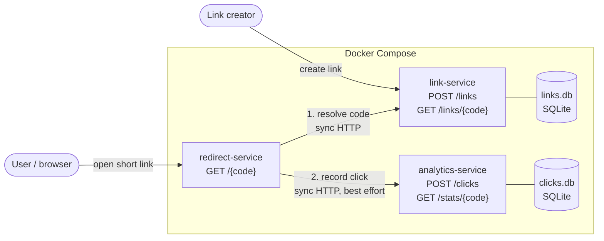

# ADR-001: Architectural style – small services with Docker Compose

- **Status:** Accepted
- **Date:** 22 October 2026
- **Jira:** XP-23
- **Decider:** Santiago Guerrero (Product Owner, Sprint 2)

## Context

LinkLite is a URL shortener with click analytics. It is the vehicle for the real deliverable of the project: an intelligent CI/CD pipeline with AI-augmented quality gates. The architecture must therefore serve two goals:

1. **Deliver the product** with a small team (one developer, about 6 hours per sprint).
2. **Make architectural properties visible** to the pipeline and the observability layer. The brief requires an Architectural Feedback Log (Ops Pattern P1), where pipeline failures are traced back to the architectural decision they expose (coupling, dependency, interface contract), and at least one dashboard or alert that surfaces an architectural insight, such as a bottleneck or an unexpected dependency.

The workload has three parts with different quality needs:

| Part | Traffic | Main quality attribute |
|---|---|---|
| Create and manage links | Low | Correctness and input validation (security) |
| Redirect a short code | High, user-facing | Latency and availability |
| Record and query clicks | High writes, rare reads | Throughput; must not slow the redirect |

## Options considered

**A. Modular monolith.** One FastAPI application with internal modules.
Simplest to build and deploy. However, every module shares one process and one deployment, so coupling stays hidden inside function calls. A failure in analytics can only show up as a slow redirect, never as a broken interface between components. P1 and the architectural insight would have little to show.

**B. Small services (chosen).** Three FastAPI services, each with its own data store, talking over HTTP, started together with Docker Compose.
Each service can be tested, scanned and deployed on its own, and the dependencies between them are explicit HTTP contracts that the pipeline and the metrics can observe.

**C. Event-driven services with a message broker** (for example Redis Streams or RabbitMQ between redirect and analytics).
Removes the runtime coupling between redirect and analytics, but adds a broker to run, test and monitor. This is too much for Sprint 2. It stays a candidate if the coupling described below turns out to be a real problem.

## Decision

Use **option B**: three small services, each owning its data, deployed with Docker Compose as infrastructure as code.

| Service | Responsibility | Owns |
|---|---|---|
| `link-service` | Validate URLs and create, read and manage links | `links.db` |
| `redirect-service` | Resolve a short code and redirect the user (hot path) | Nothing (stateless) |
| `analytics-service` | Record clicks and answer statistics queries | `clicks.db` |

Rules that follow from the decision:

- **Single responsibility per service** (lecture T03). No service reads another service's database; all access goes through HTTP contracts.
- **Validation at the edge.** `link-service` is the only entry point for user-supplied URLs and rejects anything that is not a well-formed `http`/`https` URL. `redirect-service` checks the scheme again before redirecting (defence in depth against open redirect and `javascript:` URLs).
- **Analytics is best effort.** If `analytics-service` fails or is slow, the redirect still happens; the click is lost and the failure is logged.
- **SQLite per service** keeps the system runnable with one `docker compose up` and no external database. It can be replaced later without changing the HTTP contracts.

## Consequences

**Positive**

- Each service can be linted, tested and scanned on its own, so pipeline failures point to a specific component and contract (input for P1).
- Explicit dependencies can be measured: latency per service and per call is visible to Prometheus and Grafana in Sprint 4.
- The hot path (`redirect-service`) is small and stateless, so it can be scaled on its own.

**Negative, accepted on purpose**

- **Runtime coupling on the hot path.** In this first version, a redirect makes two synchronous HTTP calls: one to `link-service` and one to `analytics-service`. Each redirect is therefore as slow as the slowest of the three services. This is the simplest working design, and we accept it on purpose so that it can be measured instead of guessed. The observability layer (Sprint 4) will show how much latency each call adds. If the data confirms the bottleneck, the planned structural fixes are: (1) record clicks asynchronously (background task or option C), and (2) cache resolved codes in `redirect-service`. Any such change will be recorded in a new ADR and, if it came from a pipeline failure, in the Architectural Feedback Log.
- **More moving parts than a monolith**: three Dockerfiles, three test suites and network calls that can fail. Mitigated by Docker Compose, a shared CI workflow and health checks on every service.
- **Interface contracts can break.** A change in `link-service` responses can break `redirect-service` without either service's unit tests failing. Contract and integration tests are added to the pipeline as the project grows; any break caught by the pipeline goes to the Architectural Feedback Log.
